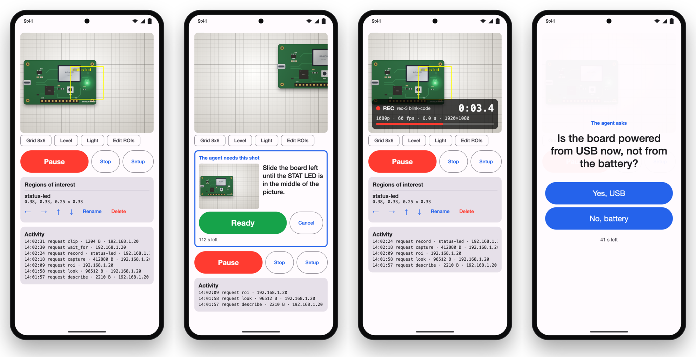

# lookout

Lookout turns a spare Android phone into a camera that coding agents can see through. Claude Code connects to an MCP server that runs on the phone, over the local network. Scripts can use the same features through a plain HTTP API.

## See it work

**[Watch the demo on gstark.com](https://gstark.com/projects/lookout/)** (84 s, with narration) or [download the MP4](https://github.com/gstark/lookout/raw/main/assets/screens/lookout-demo.mp4).

The demo starts with the problem: the agent can build and flash firmware, but it cannot see the board. Then Claude Code looks at the board through a phone on an arm. It asks the person to center the STAT LED, records 6 s at 60 fps, reads the blink code from a brightness trace, and finds the fault.

The video is a [HyperFrames](https://hyperframes.heygen.com) project in `media/demo`. Its README says how to edit and render it again.

From left to right:

- **Main:** the live preview with a named region, the Activity feed of agent requests, and Pause.
- **Guide:** a `capture` or `record` call with `guide_text`. The phone shows the shot the agent wants, and the agent takes it after the person taps Ready.
- **Recording:** a countdown while `record` runs.
- **Ask:** a full-screen question from `ask`.
- **Setup:** the QR code and the `claude mcp add` command.

In portrait, the guide sits below a full-width preview. In landscape, the guide and the preview are side by side:

The screens are mock-ups of the Compose UI in `app/`.

## What an agent can do

- `look`: a fresh, right-sized frame (about 1024 px), optionally cropped to a named region, with a labelled grid.
- `capture`: a full-resolution still for small text, with lens, zoom, focus and torch for that shot.
- `wait_for`: block until the view changes, something moves, the scene goes still, a read value passes a limit (`condition=value`), or the person taps Done.
- `history`: one contact sheet of the last minutes.
- `record` and `clip`: record video at 30 or 60 fps for up to 60 seconds, then read it back as contact sheets, single frames or a brightness trace (for LED blink codes). `wait_for(condition=recording_done)` waits for the end. `GET /v1/recordings/{id}/video` downloads the MP4.
- `diff` and `baseline`: compare against a saved reference frame.
- `roi`: name regions, from grid cells or by dragging on the phone.
- `read`: on-device OCR of a display or a label. It returns text, line boxes and parsed numbers with units (`12.04 V`) as JSON, not an image. With `duration_ms` it logs the value over time as a table.
- `say` and `ask`: talk to the person near the phone.
- `point`: draw arrows, boxes and labels over the phone preview, placed on grid cells or saved regions, to show the person where to act. With buttons, it waits until the person taps Done.

## Set up

1. Build and install: `./gradlew :app:installDebug`.
2. Open Lookout on the phone and allow the camera. Turn off battery optimization when the checklist asks.
3. Tap Setup, then copy the `claude mcp add ...` command and run it on your Mac.
4. Give the phone a DHCP reservation on your router, so its address does not change.
5. If the phone is mounted sideways, set Camera orientation to Landscape in Setup. The screen and the agent's frames then both face that way.

## Use it over Tailscale

Lookout accepts only LAN clients by default. To let agents on other networks connect, put the phone on your tailnet. WireGuard encrypts the traffic, so the bearer token does not cross a network in clear text.

1. Install the Tailscale app on the phone and connect it to your tailnet.
2. Turn on "Always-on VPN" for Tailscale in the Android settings, and turn off battery optimization for it.
3. In Lookout, tap Setup and turn on "Allow Tailscale".
4. Copy the Tailscale command and run it where the agent runs.
5. Optional: rename the phone to `lookout` in the Tailscale admin console. The agent can then use `http://lookout:8080/mcp`.

Limit the access in your tailnet policy. Give the phone a tag, such as `tag:lookout`, and grant only your agent machines access to port 8080 of that tag.

Lookout still refuses connections that arrive over mobile data, and all clients still need a token.

## Discover and pair

An agent can find a phone and ask for its own token. A person approves each request on the phone.

1. `scripts/lookout-pair.sh discover` lists the Lookout phones that the machine can reach on the tailnet. It probes each online peer at `GET /v1/hello`.
2. `scripts/lookout-pair.sh pair <host> <agent name>` shows a card on the phone and prints a 4-digit code.
3. The agent tells the person the code. The person compares it with the code on the phone and taps Allow.
4. `scripts/lookout-pair.sh wait <host> <pair_id>` prints the token and a `claude mcp add` command.

The script needs `curl`, `jq` and, for `discover`, the `tailscale` CLI.

- A token from a tailnet pairing works only from the tailnet address that paired. A machine with a new address must pair again. Use the IPv4 address that `discover` prints, not a MagicDNS name, so the client address stays the same.
- A paired token cannot read the setup QR code or open the web page. Those hold the owner token.
- Setup lists the paired agents. Revoke removes one agent and leaves the others.
- Claude Code loads a new MCP server when a session starts. In the session that paired, the agent can use the REST routes with its token.
- "Accept pairing requests" in Setup closes pairing. Lookout also blocks an address for 10 minutes after the person denies 3 requests from it.

See `CLAUDE.md` for the module layout and the test commands.
