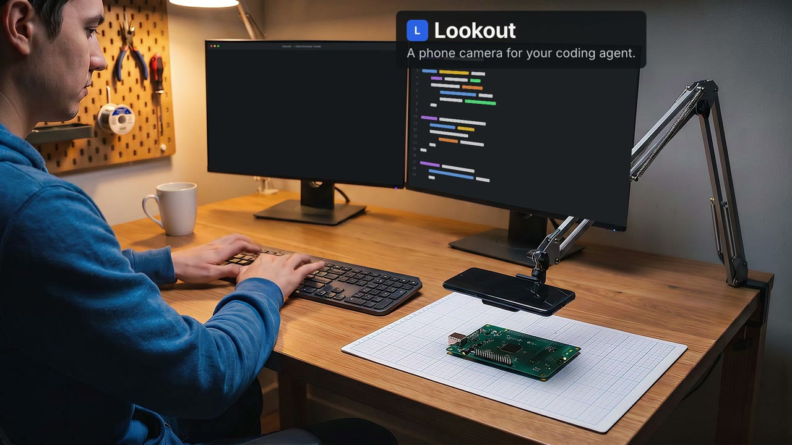
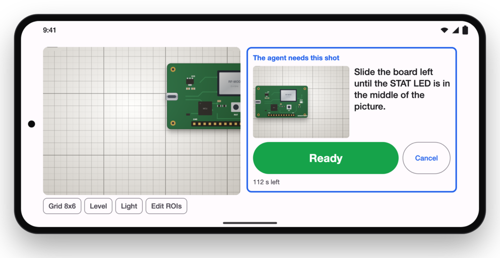

# lookout

Lookout turns a spare Android phone into a camera that coding agents can see through. The phone runs an MCP server on the local network, or on your Tailscale network. Lookout works with any agent that supports MCP. Scripts can use the same features through a plain HTTP API.

## See it work

[](https://gstark.com/projects/lookout/)

**[Watch the demo on gstark.com](https://gstark.com/projects/lookout/)** (104 s, with narration) or [download the MP4](https://github.com/gstark/lookout/raw/main/assets/screens/lookout-demo.mp4).

The demo starts with the problem: the agent can build and flash firmware, but it cannot see the board. The phone joins the tailnet, one command installs the skill, and the agent pairs with the phone after the person checks a code. Then the agent looks at the board through a phone on an arm. It asks the person to center the STAT LED, records 6 s at 60 fps, reads the blink code from a brightness trace, and finds the fault.

The video is a [HyperFrames](https://hyperframes.heygen.com) project in `media/demo`. Its README says how to edit and render it again.


From left to right:

- **Main:** the live preview with a named region, the Activity feed of agent requests, and Pause.
- **Guide:** a `look` or `record` call with `guide_text`. The phone shows the shot the agent wants, and the agent takes it after the person taps Ready. The shot runs on the phone, not in the call. When the person takes longer than `wait_ms` (default 45 s), the call returns `state: "waiting"` with a `request_id`, and `wait_for(condition=request)` gets the result later. `guide_image` can be a kept frame, an image id or a baseline name, with `guide_marks` drawn on it.
- **Recording:** a countdown while `record` runs.
- **Ask:** a full-screen question from `ask`.

In portrait, the guide sits below a full-width preview. In landscape, the guide and the preview are side by side:



The screens are mock-ups of the Compose UI in `app/`.

## What an agent can do

- `look`: a fresh, right-sized frame (about 1024 px), optionally cropped to a named region, with a labelled grid or `grid=ticks` edge rulers (showing full-frame 0..1 coordinates on crops too). `detail=full` takes a full-resolution still for small text. `sharp=true` takes a short burst and returns the sharpest frame, and metadata includes `sharpness` (plus `moving: true` when the scene moved). `save_as` and `baseline` save from a still burst and refuse blurred frames unless `force=true`. Lens, zoom, focus (including `focus=roi` on an `roi`) and torch apply for that call only. When the view is black, it returns JSON with `dark: true` and no image unless `force=true`. To keep results short, the frame data has camera fields (including `focus_mm`) only when they changed since the last result to that client, and battery and thermal fields only at a warning level. `verbose=true` returns all of them. When focus is at the lens close limit, it adds `focus_at_limit: true` and a hint. When a scale is set, it adds `mm_per_px` for the returned image. Result numbers have at most 3 decimals.
- `wait_for`: block until the view changes, something moves, the scene goes still, a read value passes a limit (`condition=value`), the person taps Done, or a guided shot finishes (`condition=request`). The default `timeout_ms` is 50000, because some MCP clients stop a call at 60 s.
- `history`: one contact sheet of the last minutes.
- `record` and `clip`: record video at 30 or 60 fps for up to 60 seconds, then read it back as contact sheets, single frames, a brightness trace (for LED blink codes) or an edge track (`mode=track`: how far and when a part moved, with sub-pixel positions, holds, moves and the position after each mark, in mm automatically when a scale is set). `wait_for(condition=recording_done)` waits for the end and can return a requested `clip` (or `sheet=false` for the summary only) in the same call. The recording is ready about a second after it ends (`finalize_ms`), with motion data from the preview frames (`motion_source: "preview"`). A background pass then decodes every frame for exact motion data; `exact=true` waits for it. An `roi` uses `look` coordinates everywhere; when 16:9 video is narrower than a `look` frame, `video_crop` gives the part it covers. The `video_url` in the recording summary downloads the MP4. A sheet fits as many tiles as stay readable, so thin strips of a region fit more, up to 200. Tiles come as arrays in the order of `tile_columns`, and `layout` gives the sheet grid so a script can cut the tiles out.
- `record(action=mark)`: label a moment on the recording timeline. A mark is "now" by default. `at` (an ISO time or `t_ms`) and a `marks` list add marks later, also after the recording ended, for example from a script log. `client_now` corrects for a difference between the phone clock and the computer clock. `clip at_marks=true` shows one tile per mark, and `offset_ms` shifts the tiles.
- `diff` and `baseline`: compare against a saved reference frame, or pass `image=false` to `diff` for the score and regions as JSON only. `diff` first aligns the frames for a small camera shift (translation only, up to 12.5% of the frame) and reports it as `global_shift_px`, or `aligned: false` when the frames do not line up. With an `roi`, it also gives `dx` and `dy`: how far the content of the roi moved in px of frame a, with `shift_confidence`, and in mm with `mm_per_px` or the stored scale.
- `crop`: a closer view of a frame that a result returned, or of a baseline, with no new shot. It uses the frame as kept (a still at full resolution), so it works after the scene changed and does not wake the phone. Supports `grid=ticks` and adds `mm_per_px` when a scale is valid.
- `roi`: name regions, from grid cells or by dragging on the phone.
- `scale`: store one resolution-independent mm scale from two points and a known distance, valid for one plane at a fixed distance. `track`, `diff`, `look` and `crop` then include mm for their image pixels. A `moved` event clears it, and a lens or zoom change marks it stale. `describe` also lists each lens's focal length, field of view and close focus limit in mm.
- `read`: on-device OCR of a display or a label. It returns text, line boxes and parsed numbers with units (`12.04 V`) as JSON, not an image. With `duration_ms` it logs the value over time as a table.
- `say` and `ask`: talk to the person near the phone.
- `point`: draw arrows, boxes and labels over the phone preview, placed on grid cells or saved regions, to show the person where to act. With buttons, it waits until the person taps Done.
- `caption`: show text over the camera view, such as the command the agent just sent, with an optional duration. The phone preview shows it, and every image of a frame taken while it shows has it at the bottom, including history and recording clips. During a recording it also adds a mark.
- `done`: tell the phone that the agent has finished for now. The phone then sleeps.

## Images for scripts

- Every tool that returns an image takes `inline`. With `inline=false`, the result has the metadata and an `image_url`, and no image, so a script can read the file and the agent pays no image tokens.
- `image_url` and `video_url` are absolute URLs, such as `http://192.168.1.23:8080/v1/frames/c12.jpg?exp=1764079200&sig=...`. They work for 10 minutes with no token, so `curl` or ffmpeg can fetch them. `describe` gives `base_url`, the address that the client reached the phone at.
- The signature is an HMAC-SHA256 over the method, the path and the expiry, with a random key that the server makes when it starts. It opens only that one image or video. `width` and `grid` can be added to an image URL.
- `describe` gives `upload_url`, signed for `POST /v1/uploads` only. A script sends a JPEG or PNG body (at most 4 MB) with no token and gets `{"image_id":"c12"}` back, for `guide_image`. The server scales the image to 1280 px and accepts 4 uploads at once, then one every 15 s.
- Each frame that a result returned stays for at least 10 minutes: a still at full resolution, a preview frame at its own size. `diff`, `crop` and `GET /v1/frames/{id}.jpg` can use it. The kept frames use at most 128 MB. When that limit drops a frame early, the error says so.

## Sleep

Lookout sleeps to save battery. By default, the camera stays warm while charging and uses auto mode on battery (staying open for 5 minutes after a call). Lookout sleeps after 15 minutes with no agent request and no touch on the phone, or soon after an agent calls `done`. Asleep, the light turns off, the camera closes in every power mode, and the screen can turn off even with "Keep screen on". The server keeps listening. The next agent request or a tap on the phone wakes it. The light stays off after a wake.

Lookout does not sleep while a wait, a recording or a question is active, or within one minute of a touch on the phone. Set the idle time in Setup. 0 turns the idle timer off, and `done` still works.

## Set up

1. Build and install: `./gradlew :app:installDebug`.
2. Open Lookout on the phone and allow the camera. Turn off battery optimization when the checklist asks.
3. Install the skill where the agent runs: `npx skills add gstark/lookout`. Then ask the agent to find the phone and pair. "Discover and pair" below gives the steps.
4. Give the phone a DHCP reservation on your router, so its address does not change. Setup shows the address.
5. If the phone is mounted sideways, set Camera orientation to Landscape in Setup. The screen and the agent's frames then both face that way.

## Use it over Tailscale

Lookout accepts only LAN clients by default. To let agents on other networks connect, put the phone on your tailnet. WireGuard encrypts the traffic, so the bearer token does not cross a network in clear text.

1. Install the Tailscale app on the phone and connect it to your tailnet.
2. Turn on "Always-on VPN" for Tailscale in the Android settings, and turn off battery optimization for it.
3. In Lookout, tap Setup and turn on "Allow Tailscale".
4. Install the skill where the agent runs, and let the agent pair. Setup shows the tailnet address of the phone.

Limit the access in your tailnet policy. Give the phone a tag, such as `tag:lookout`, and grant only your agent machines access to port 8080 of that tag.

Lookout still refuses connections that arrive over mobile data, and all clients still need a token.

## Discover and pair

An agent can find a phone and ask for its own token. A person approves each request on the phone.

Install the skill where the agent runs, for example in a dev container:

```
npx skills add gstark/lookout
```

The skill gives the agent a command-line tool, `scripts/lookout.mjs`. It needs Node 18 or later and has no dependencies. The agent then does these steps:

1. `lookout discover` lists the Lookout phones that the machine can reach on the tailnet. It probes each online peer at `GET /v1/hello`, and it needs the `tailscale` CLI. Without that CLI, or on a LAN with no tailnet, set `LOOKOUT_HOSTS` to the address that Setup shows.
2. `lookout pair <host> <agent name>` shows a card on the phone and prints a 4-digit code.
3. The agent tells the person the code. The person compares it with the code on the phone and taps Allow.
4. `lookout wait <host>` saves the token in `~/.config/lookout/devices.json`.
5. `lookout look` and `lookout api <METHOD> <path>` use the camera through the REST routes, in the same session.

- A token from a tailnet pairing works only from the tailnet address that paired. A machine with a new address must pair again. Use the IPv4 address that `discover` prints, not a MagicDNS name, so the client address stays the same.
- Setup lists the paired agents. Revoke removes one agent and leaves the others.
- `lookout mcp` prints the URL and the `Authorization` header of the MCP server on the phone. Add them to the MCP settings of your agent. Most agents load a new MCP server when a session starts.
- Setup also shows the owner token. Use it for scripts and for the web page at `http://<phone>:8080/`, which shows the live view.
- "Accept pairing requests" in Setup closes pairing. Lookout also blocks an address for 10 minutes after the person denies 3 requests from it.

See `CLAUDE.md` for the module layout and the test commands.
